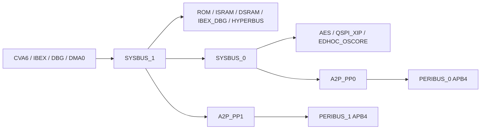

# FU3 bus - SystemC / TLM-2.0

Functional bus for the FU3 virtual platform, using C++17 and SystemC 2.3.4.
It provides routing, arbitration, peripheral transfers, validation and basic
access control. CPU, memory, CSR and loader implementations belong to the platform.
Fake IPs are test fixtures only.

## Directory layout

```text
include/fu3_bus/           Public API and transaction metadata
src/                      Implementation and FU3 address map
tests/                    Configuration, behavior, contention and contract tests
tests/support/            Fake masters and sparse targets
tests/installed_consumer/  Installed package tests
tests/coexist/             FX1/FU3 link test
cmake/                    CMake package configuration
docs/                     Model contract and validation results
scripts/                  Optional local helpers, ignored by Git
build/                    Generated files, ignored by Git
```

## Topology



The latest Common Spec v2.0 workbook is authoritative: PERIBUS_1 connects
through A2P_PP1 directly to SYSBUS_1; PERIBUS_0 stays behind SYSBUS_0.
This supersedes the earlier HAS-figure routing decision. Addresses remain
unchanged. See [Common baseline decisions](docs/COMMON_REBASELINE.md).

`BusConfig::fu3()` enables four initiators and 36 targets. Bind every enabled
target before `sc_start`; unused initiators may remain unbound. Disable missing
targets before constructing the fabric; their addresses become unmapped.
Configuration is fixed during elaboration. Names, ranges, overlaps, widths and
paths are validated. Regions use `[base, base+size)`. Intermediate routers keep
global addresses; leaf routers translate to local offsets. Payload fields are
restored on return, including exceptions.

## Integration

```cpp
#include <fu3_bus/bus_system.h>
auto cfg = fu3_bus::BusConfig::fu3();
fu3_bus::BusSystem fabric{"fabric", cfg};
ibex.socket.bind(fabric.initiator("IBEX"));
cva6.socket.bind(fabric.initiator("CVA6"));
// Native AP_DMA uses fu3_bus::DmaAdapter; see the integration contract below.
fabric.target("IBEX_ISRAM").bind(ibex_sram.socket);
fabric.target("SYSCSR").bind(syscsr.socket);
// Bind all other enabled targets, or disable them in cfg before construction.
// The boot controller calls finish_staging() before releasing CVA6 reset.
```

Call `b_transport` from an `SC_THREAD`, not an `SC_METHOD` or directly from
`sc_main`. Executables define `int sc_main(int, char**)`; the library defines
neither `main` nor `sc_main`. See `tests/installed_consumer/main.cpp` for an example.

Loaders may use `transport_dbg` to access memory without simulated delay. This
intentional backdoor bypasses access policy and must not replace CPU traffic.
Tests verify image-byte loading and readback in ISRAM. The library does not
execute firmware or parse ELF files.

## CPU/DMA transaction contract

Default FU3 ports `CVA6`, `IBEX`, `DBG`, `DMA0` require `Access` on every
functional transaction. Missing metadata returns GENERIC_ERROR; the fabric never
silently guesses instruction/data or beat width. `transport_dbg` is for loaders.

```cpp
// tx already has command, global address, data, length and streaming_width >= length.
// DMA: five halfword FIFO beats, length = 10 bytes.
{
    fu3_bus::ScopedAccess request(tx, 2, fu3_bus::Burst::Fixed);
    dma.socket->b_transport(tx, delay);
}
// CPU instruction fetch: read, length=4, address aligned to four bytes.
{
    fu3_bus::ScopedAccess fetch(tx, 4, fu3_bus::Burst::Increment, true);
    cpu.socket->b_transport(tx, delay);
}
```

- Beat width is 1/2/4 bytes, naturally aligned; length must be a multiple of it.
  INCR advances the address; FIXED holds it while advancing data/byte-enable position.
- DMA accepts at most 16 beats. CPU/DBG have a configurable VP guard of 256 beats
  (`max_beats`), not a burst-length value established by the HAS. WRAP, atomics
  and streaming wrap are unsupported and must not be silently substituted.
- Check the entire footprint before the first beat. FIXED near an aperture end
  is valid when one beat fits. An INCR request crossing a target is rejected whole.
- `Burst` describes functional address progression, not AXI AxBURST encoding.
  Ingress emits single incrementing operations; fixed-address requests become
  repeated singles. DBG rejects fixed progression and non-word beat sizes.
- Word interfaces from Table 7-1 receive aligned 4-byte operations. Narrow accesses
  use lane enables and read extraction without RMW; other endpoints retain exact
  beat sizes. QSPI receives single operations with one outstanding maximum.
  Byte enables repeat over payload bytes and survive beat boundaries.
- No read-modify-write on CSR. Targets must honor byte enables. `Strobe = Full` is confirmed
  by the user to mean full byte-write-strobe support, including partial/sparse
  writes, not mandatory all-byte writes. IP adapters must satisfy this contract.
  Both PERIBUS_0 and PERIBUS_1 use APB4: the user requires matching versions,
  using the explicit APB4 version of PERIBUS_1 for both. This clarifies the PDF
  label on PERIBUS_0. Transfer-size adaptation remains a separate question.
- Common Full strobes apply at Timer, WDT, I2C, UART, SPI and AP_HBCTRL
  model boundaries. Word-register endpoints merge enabled lanes internally;
  no bus CSR read-modify-write is performed. Zero write strobes cause no effect.
- AP_PLIC is the explicit Common exception: every functional access requires
  an aligned complete word with all lanes enabled. The guard applies before
  widening or dispatch, independently of the peer's provisional CSR map.
- Production AP_DMA needs `fu3_bus::DmaAdapter` to translate its native
  metadata and lane strobes; see the [integration contract](docs/MODEL_CONTRACT.md#production-ip-integration-contract-2026-10-20).
- Downstream error stops the request; completed beats are not rolled back.
  Exceptions restore payload fields and release admission, order and pipeline leases.
- Custom initiators in `BusConfig{}` default to `require_access=false` for legacy
  TLM models. Without metadata they issue linear byte blocks, not AXI bursts;
  legacy A2P accepts aligned 1/2 bytes or word-aligned 4..64-byte blocks. Do not
  use this mode as a replacement for FU3 CPU/DMA instruction/transfer semantics.

## Admission, ordering and pipelines

- CPU admission is 2 total read/write requests; DBG is 1; DMA has separate 4-read
  and 4-write gates. Excess callers wait FIFO rather than fail. A slot spans the
  complete request, including time waiting for its ordered turn.
  The CPU combined limit is a conservative VP interpretation of Table 7-1, not
  an explicit per-direction limit. HyperBus/EDHOC target capacities default to
  one because their table entries are unspecified; see MODEL_CONTRACT.md for
  the PDF evidence and selected defaults.
- Requests sharing master, direction and `Access::ordering_id` remain ordered.
  Different ordering IDs can complete independently. ID zero is the default;
  adapters must use distinct IDs only where out-of-order completion is allowed.
  This is an ordering token, not a signal-level AXI ID implementation.
- Output dispatch is FIFO per beat, confirmed by the user; there is no fixed
  master priority. Arrival order is measured at each arbiter after input delay;
  simultaneous arrivals follow scheduler enqueue order. Independent outputs do
  not share a global completion-order constraint. One-stage APs at masters and AP_SB0 release
  before downstream completion; leaf occupancy is separately bounded. SRAM/AES
  allow four pending operations, ROM/QSPI one. Custom AXI target capacity is
  `TargetConfig::outstanding`; its default is one. APB always serializes.
- Slow IPs do not retain SYSBUS dispatch ownership. Independent outputs, including
  those behind AP_SB0, can overlap. A stalled IP can exhaust its target/master
  capacity; no timeout is invented. `peak_outstanding` reports admission peaks.
- AP_PP0/1 and A2P retain serialized APB access. Stage timing is a functional LT
  approximation, not a model of independent AXI channel handshakes or RTL throughput.
- Input and downstream delays are consumed once; return delay is zero. Defaults:
  AP 2 ns (`axi_cycle_ns`), PP 10 ns (`apb_cycle_ns`), router decode 2 ns
  (`router_latency_ns`), A2P setup+access two APB cycles per beat. These are VP
  parameters, not confirmed RTL frequencies. APB timing tests include all stages.
- Functional requests yield to the kernel. Validation/policy failures consume
  router latency so an error loop does not starve a time-scheduled peer. With
  all latencies zero, fairness is only among runnable processes; an infinite
  delta-cycle loop cannot advance physical time. DMI and `nb_transport` are disabled.

## Access, boot and reset

- CPU permissions follow Common MemoryMap: CVA6 cannot access Ibex SRAM
  or debug control; Ibex loses access to CVA6 SRAM after handoff and cannot
  write its own executable SRAM afterward. Trusted boot verification reads
  remain allowed during staging. ROM remains Ibex-only and read-only.
- MMIO, debug control, DSRAM and HyperRAM reject instruction fetches.
  CPU PMP/ePMP, privilege and cache policy still belong to the CPU/platform.
- Each SRAM reserves its final 4 KiB for debug code, leaving 60 KiB for a
  normal image. Trusted CPU adapters set `Access::debug` for debug-mode accesses.
  DBG and the explicit untimed loader backdoor are separate platform facilities.
- Stop IBEX traffic and drain it before `finish_staging()`. The call throws if
  Ibex work is pending. Stop producers and call `quiesce()` outside transport
  callbacks, reset attached IPs, call `reset()`, release IP reset, `resume()`
  and restart producers. Debug loaders must stop separately. No hung-target
  timeout/cancellation policy is invented; bus reset itself requires idle.
- Clock/reset pins, CGF, IRQ, HyperRAM readiness and peripheral CSR behavior are
  platform/IP responsibilities. The bus does not invent missing register maps.
- `transport_dbg` bypasses timing and access policy intentionally for firmware
  loading, but still rejects cross-window requests. It is not a CPU execution path.

| Condition | TLM response |
|---|---|
| Unmapped, cross-window, misalignment | ADDRESS_ERROR |
| Unsupported command, denied policy, instruction write | COMMAND_ERROR |
| Unsupported beat/count/burst/streaming | BURST_ERROR |
| Invalid byte enables | BYTE_ENABLE_ERROR |
| Missing required metadata, null data, zero length | GENERIC_ERROR |

## Build and test

Run from this directory in a Linux or WSL Bash shell. Use an installed SystemC
with a compatible compiler, C++ standard and ABI. Replace the example prefix.
No local scripts are required. Stop if any step fails.

```bash
export SYSTEMC_HOME=/absolute/path/to/systemc-install
for mode in static shared; do
    shared=OFF
    if [ "$mode" = shared ]; then shared=ON; fi
    cmake -S . -B "build/$mode" -DSYSTEMC_HOME="$SYSTEMC_HOME" -DCMAKE_BUILD_TYPE=Release -DBUILD_SHARED_LIBS="$shared" -DFU3_BUS_BUILD_TESTS=ON || break
    cmake --build "build/$mode" --parallel 4 || break
    ctest --test-dir "build/$mode" --output-on-failure || break
    cmake --install "build/$mode" --prefix "$PWD/build/$mode/install" || break
    cmake -S tests/installed_consumer -B "build/$mode/consumer" -DCMAKE_PREFIX_PATH="$PWD/build/$mode/install;$SYSTEMC_HOME" || break
    cmake --build "build/$mode/consumer" --parallel 4 || break
    ctest --test-dir "build/$mode/consumer" --output-on-failure || break
done
```

Each build runs seven regression tests and six installed-consumer tests. Enable
`-DFU3_BUS_BUILD_IP_TESTS=ON` alongside `FU3_BUS_BUILD_TESTS` to add four
production-IP scenarios (adapter, DMA/SPI/UART, Timer/PLIC and WDT/reset). This
requires the sibling DMA0/AP_DMA, SPI, UART, Timer, WDT and PLIC sources; the
exported bus library does not depend on them. With
FX1 available at its repository location, also run the coexistence check:

```bash
cmake -S tests/coexist -B build/coexist -DSYSTEMC_HOME="$SYSTEMC_HOME" -DBUILD_SHARED_LIBS=ON
cmake --build build/coexist --parallel 4
ctest --test-dir build/coexist --output-on-failure
```

This adds one test: 27 executions for core builds, or 35 with production-IP
tests enabled in both static and shared builds. The optional `scripts/`
helpers are ignored by Git and are not required after cloning.

The public CMake target is `fu3::bus_system`, with `SystemC::systemc` as a PUBLIC
dependency. Use the imported target to retain SystemC compile/link settings.
Namespaces, include paths and package targets are separate from FX1. Native
Windows DLL support is not validated; the verified environment is WSL/Linux.

- [Model contract and integration details](docs/MODEL_CONTRACT.md)
- [Recorded validation results](docs/VALIDATION.md)
- [Production-IP integration coverage and remaining work](docs/INTEGRATION_VALIDATION.md)
- [Repository integration guide](docs/REPOSITORY_HANDOFF.md)

The [scoped suite](tests/scoped_suite/CMakeLists.txt) builds the seven owned IP
models and their integration tests together. See the
[rebaseline commands](docs/COMMON_REBASELINE.md#reproducible-validation) and
[validation record](docs/VALIDATION.md) for the current evidence.

The suite also uses current QSPI/GPIO/IO_PAD sources as read-only peers when
`FU3_BUS_BUILD_PULLED_PEER_TESTS=ON` (default). This adds three scenarios and no
installed bus dependencies. See the [post-pull review](docs/POST_PULL_REVIEW.md)
for the remaining endpoint strobe conflicts; one scenario characterizes those
conflicts rather than asserting Common conformance.
