# Connecting GvuTop to the SAURIA core

This guide describes how the vector unit `GvuTop` (`has/rtl_ref_gvu_top.h`) is connected to the SAURIA core in the instruction path of `HasNpuTop`, and how the data flow controller (DFC) configures and starts it through the register file of `gvu_core`. It is written for two readers:

- the **hardware team**, who need, for every flow, what the RTL has, what the model does and where the two differ, each with a file and line on both sides, so that they can anchor their design on the model;
- the **group that takes over the model**, who need to know what is connected, how to switch it on, how to check it and what is still open.

Everything here runs in one process on one clock: `HasNpuTop` (DFC, DMA, SRAM, core port), `PsmStreamTap` and `GvuTopStream` (the stream between the PSM and the unit), and `GvuTop` itself. The full flow of section 1.3 is the default; with every knob of section 1.3 set to 0 the model runs the earlier functional path and gives the same values and cycles as before these flows existed.

**Labels.**
- **READ**: read from the code or the RTL, with a file and line.
- **MEASURED**: a number from a run; section 7 gives the command.
- **ESTIMATED**: a parameter or number nobody has measured (for example the latency of one register write).
- **PROPOSAL**: not in the RTL; the model does it so that the hardware team can take it as a reference.

**Paths.** Paths of the form `neo_core/...` and the files ending in `.sv` are files of the RTL of the hardware team; they are not in this package and are quoted so that a reader who has the RTL can check each statement. Line numbers of RTL files refer to the RTL drop that the patch package was made against ("as delivered"). Line numbers of model files refer to the sources of this package; if they drift after an edit, the names of the functions stay.

Companion documents: `GVU_DFC_REFERENCE_FLOW.md` (one block diagram of the recommended flow, the register map, the order of the writes of each operation and the rules, for the RTL), `SLICE_CONCAT_ON_GVU.md` (slice and concat on the unit), `GVU_TOP_IMPLEMENTATION_AND_TEST.md` (the unit, its ports and tests), `GVU_RTL_CONFORMANCE.md` (every block against the RTL), `GVU_PIPELINE_STEPS.md` (stage tables), `KNOWN_LIMITATIONS.md`, `BUILD_AND_RUN.md`, and the patch package for the hardware team (the RTL patches quoted below by their ids).

## 1. Overview

### 1.1 The flows

| # | Flow | Section | Where the model implements it |
|---|---|---|---|
| 1 | GEMM_FUSED epilogue: PSM write, 4-packet FIFO, `valid` / `ready`, nine-stage pipeline, write-back | 2.1 | `PsmStreamTap`, `GvuTopStream` (`has/gvu_top_stream.h`) |
| 2 | End of a layer: `oc_last` / `oc_tile_last`, where the unit leaves `GEMM_FUSED` | 2.2 | `PsmStreamTap::push`, `StreamPacket::call_last`, `GvuTop::stream_exit` |
| 3 | Per-channel scale and shift (sbank + address generator in the RTL, side channel in the model) | 2.3 | `StreamPacket::S`, `::s` |
| 4 | Activation table load (`LUT_ACT_INIT`) | 2.4 | `GvuTopStream::begin_layer_regs` |
| 5 | Core stop on a full FIFO (`o_stream_stall`) | 2.5 | `HasNpuTop::stream_room`, core port `set_stream_backpressure` |
| 6 | Max pool | 2.6 | `GvuTopStream::job_step_pool_regs`, `pool_geom` |
| 7 | Residual add on the clock | 2.7 | `GvuTopStream::job_step_add_regs`, `HasElemwise` |
| 8 | DFC configures and starts the unit through the register file | 2.8 | `has/gvu_regs_dfc.h`, `has/gvu_reg_master.h`, `has/rtl_ref_gvu_config_regs.h` |

### 1.2 Block diagram of the full flow (the configuration closest to the RTL)

```mermaid
flowchart LR
  subgraph DFC["HasNpuTop: DFC thread"]
    SEQ["register sequences<br/>gvu_regs_dfc.h"] --> MST["GvuRegMaster<br/>L edges per write"]
  end
  MST -- "AXI-Lite write: byte address, data, strobe" --> CFG["GvuConfigRegs<br/>Reg 0..8 (RTL), Reg 9..15 (proposal)"]
  subgraph CORE["SAURIA core (RTL-accurate port)"]
    PE["PE array"] --> PSM["PSM"]
  end
  PSM -- "SRAM-C write: address, 32 x int32, lane mask" --> HOOK["write hook (set_obp_inline)<br/>one packet per run of lanes of one channel"]
  HOOK --> SRAMC["SRAM-C (int32 psum, as in the RTL)"]
  HOOK -- "push" --> TAP["PsmStreamTap<br/>FIFO of 4 packets"]
  TAP -- "valid, data, oc_last, oc_tile_last" --> GS["GvuTopStream"]
  GS -- "ready" --> TAP
  CFG -- "pipe_en, opcode, zero point, pooling and residual fields" --> GS
  GS --> GVU["GvuTop (stream mode, 9 stages)"]
  GVU -- "pipe_done wire" --> DFC
  GVU -- "pipe_done: clears Reg 0 bit 0, sets bit 1" --> CFG
  GVU -- "int8 result, 10 edges after the push" --> SRAMC
  TAP -. "o_stream_stall: FIFO full and no packet leaving,<br/>the whole core holds" .-> CORE
  DRAM["DRAM operands"] --> ELEM["HasElemwise<br/>chunks, DMA, ping-pong"]
  ELEM -- "residual add runs, max pool runs" --> GS
```



The dashed arrow is the back-pressure of section 2.5. Residual add and max pool (right side) reach the same `GvuTop` instance as the GEMM_FUSED stream; they never run at the same time (an ELEM_WISE instruction starts with the unit idle).

### 1.3 Knobs

| Knob | Values | Meaning |
|---|---|---|
| `HAS_GVU_TOP` | unset / 0, 1, 2, 3 | 0: the model's own epilogue. 1 and 2: **level A**, the PSM write hook calls `GvuTop` as a function and gets the result in the same cycle (2 also charges the table load of the `GvuTop` path). 3: **level B**, `GvuTop` sits next to the core on the same clock behind the stream of sections 2.1 to 2.5 |
| `HAS_GVU_STALL` | 0, 1, 2 | 1: the core stops on `o_stream_stall` as the RTL does (level B only). 2: test only, the stall is computed and counted but not applied |
| `HAS_GVU_STREAM_HOLD=a,b` | edges | test only: holds the `ready` of the unit low between two edges to fill the FIFO |
| `HAS_GVU_ELEM_CLK` | 0, 1 | residual add and max pool as jobs on the clock of the unit instead of a function call (level B only; implied by `HAS_GVU_REGS=1`) |
| `HAS_GVU_REGS` | 0, 1 | the DFC configures and starts `GvuTop` through the register file (level B only) |
| `HAS_GVU_REG_LAT` | integer, default 4, minimum 2 | clock edges of one register write seen by the DFC (**ESTIMATED**: AW and W handshake, `axi_lite_2ram`, B response) |
| `HAS_GVU_REGS_ADD` | 0, 1, default 1 | 0: the residual add stays outside the register file (its parameters go straight to the unit's ports) |
| `HAS_GVU_TOP_DUMP=<file>` | path | one line per epilogue beat (levels 1 and 3), for byte comparison between levels |
| `-DGVU_GEMM_STREAM_DEPTH=11` | build option | pipeline depth of the RTL (pure delay stages; values unchanged) |
| `HAS_REQ_NARROW=1` | | the narrowing after the round-shift wraps (RTL) instead of saturating to 16 bits |
| `HAS_GVU_AGU_ND` | 0, 1, 2 | multi-dimensional address generator for slice / concat on the unit; described in `SLICE_CONCAT_ON_GVU.md` |

**The full flow** is `HAS_GVU_TOP=3 HAS_GVU_STALL=1 HAS_GVU_ELEM_CLK=1 HAS_GVU_REGS=1` (plus `HAS_GVU_AGU_ND=1` for slice and concat) and is the default of this package (`CODE_MAP.md`); setting a knob to 0 returns to the simpler path it replaces. Its parts: the stream through the tap with the real FIFO and back-pressure, the layer left by the flags of the stream, max pool and residual add on the clock, and every start and configuration through the register file. It is the flow that follows the RTL most closely, including the parts the RTL does not have yet (residual add registers, section 2.8), and it is the flow to read when anchoring RTL work on the model. The other combinations exist to compare against it.

## 2. The flows

### 2.1 GEMM_FUSED epilogue: from the PSM write to the int8 result

**RTL (READ).**
- `psm/psm_top.sv:308-312`: a write of SRAM-C is also a packet for the GVU. `stream_fifo_pop = o_psum_valid && i_psum_ready`; `stream_fifo_in_ready = (stream_count < STREAM_FIFO_DEPTH) || stream_fifo_pop`; `write_pipeline_stall = stream_write_candidate && !stream_fifo_in_ready`. `STREAM_FIFO_DEPTH` is 4 (`:38`).
- `psm/psm_top.sv:322-329`: the SRAM-C write is blocked on a stall (`o_sramc_wren`), `o_stream_stall = write_pipeline_stall`, `o_psum_valid = stream_count != 0`, `o_psum_data` is the head, `o_oc_last` / `o_oc_tile_last` are the flags stored with the head (`:353-354`).
- `gvu/gvu_pipe_controller.sv:625`: `o_psum_ready = pipe_ctrl_fsm == GEMM_FUSED_OBP`. The unit takes one packet per cycle while it is in that state.
- `gvu/gvu_top.sv`: the packet goes through a 32 x 32 multiplier (per-beat scale), round-shift, add of the zero point (`:705`, 8-bit register sign-extended to 16 bits), clamp to int8 and the activation table. The result is written to `vbank#2` through the VLSU (`gvu_pipe_controller.sv:496`, patch B1: the delivered code raises the read strobe).

**Model.**
- The write hook of `HasNpuTop` (`has/has_npu_top.h:285-340`, `set_obp_inline`) sees every SRAM-C write of the PSM with its word address, 32 int32 lanes and lane mask. It maps lane k of the word at address a to element `e = (a mod 1536) * 32 + k` and the output channel `e / npos` (`npos` = output positions of the tile), cuts the word into runs of lanes of one channel and pushes **one packet per run** into the tap. The hook is active only on the last input-channel part of a tile (earlier parts keep the int32 partial sums). In level B the SRAM-C word keeps the int32 psum as in the RTL.
- `PsmStreamTap` (`has/gvu_top_stream.h:92-240`) keeps the FIFO of 4 packets. `edge_proc` samples `i_psum_ready` in delta 0 of the edge; `commit_proc` (delta 1, after every process of the edge has run) pops the head if `valid && ready` held in the previous cycle, pushes the packets of the hook, counts a stall when the FIFO is full, and drives `o_psum_valid`, `o_psum_data`, `o_oc_last`, `o_oc_tile_last`, `o_stream_stall`.
- `GvuTopStream` (`has/gvu_top_stream.h:242`, `clock_proc` at `:1106`) drives `o_psum_ready` (the unit is in `GEMM_FUSED_ST1`), latches a packet at an edge when `valid && ready`, ticks the unit once per edge and writes each int8 result back into SRAM-C of the NPU half with the lane mask of the packet. The pipeline is `GvuTop` in stream mode (`has/rtl_ref_gvu_top.h`, `StreamProd` / `StreamBeat`, `:540-600`): multiplier 4 stages, v32int64 register 1, round-shift with int16 saturation 1, register 1, add zero point + register 1, clamp to int8 + register 1; activation table 0 = 9 stages.

**Where they differ.**
- The result goes back into SRAM-C; the RTL writes `vbank#2` port 1 (`gvu_top.sv:1389-1395`). How a GEMM_FUSED result leaves the unit towards DRAM is not described in the RTL (open question F8).
- Depth: 9 stages after the latch in the model, 11 beats from psum to the `vbank#2` write in the RTL (two of them the sbank read for the scale). `-DGVU_GEMM_STREAM_DEPTH=11` builds the model with the RTL depth (delay stages only).
- Timing of the push: for the same PSM write the model's packet enters the FIFO one cycle earlier than the RTL (the core port steps the PSM write of cycle (E, E+1) at edge E and the tap commits it in the delta cycle after E; the RTL pushes at edge E+1). The stall is still decided in the cycle of the write, as in `psm_top.sv:310`.
- A write that holds lanes of two output channels would give two packets in the model and one in the RTL; it was never seen (**MEASURED**: `writes with more than one segment 0` on both networks).

**Timing (MEASURED).**

```
edge              E-1     E       E+1     E+2   ...   E+9     E+10
PSM write hook            W
PsmStreamTap              push    (delta cycle after E)
o_psum_valid      0       0       1       0 or 1 ...
GvuTopStream                      latch   s2     ...    s9      result written back to SRAM-C
```

Push to latch 1 edge, latch to result 9 edges for every packet that is not held (112 packets of the unit test, 29,808 packets of a window of YOLOv8m). The trace is identical with the hook process created before and after the tap.

**What the core hands over (MEASURED, probe at the SRAM-C port of the PSM, `HAS_PSM_PROBE=1`, `has/gvu_psm_probe.h`).** A word is written twice per core pass with masks that never overlap; some writes have an empty mask (the beat must pass harmlessly); a write never holds lanes of two output channels on the instructions probed (instructions 40, 41, 86 to 88 of YOLOv8m); the rhythm is bursts of up to 64 beats, one per cycle, then more than 64 idle cycles, so the FIFO holds one packet at most; the last write comes 4 cycles before `o_done`.

### 2.2 End of a layer: `oc_last`, `oc_tile_last`, and where the unit leaves

**RTL (READ).**
- `psm/psm_idxcnt.sv:176-177` sets `oc_last` on the last output-channel column of **each context**, for **each SRAM-C word** that carries data of that column (`o_oc_last = outshim & |mask`).
- `oc_tile_last` is a configuration bit of the whole invocation (`config/config_regs.sv:897-901`), copied into every packet (`psm_top.sv:354`).
- `gvu/gvu_pipe_controller.sv:247-266`: `gemm_fused_last_read = i_oc_tile_last & i_oc_last` (not qualified with `i_psum_valid`); the end flag `gemm_fused_last_write` is that flag delayed by a fixed 9 beats; `:624` `o_gemm_fused_pipe_done = GEMM_FUSED_OBP && gemm_fused_last_write`; `:743-744` the controller leaves `GEMM_FUSED_OBP` on it.
- `gvu_config_regs.sv:136-138`: when the unit reports `pipe_done`, Reg 0 bit 0 (`pipeline_en`) clears itself and bit 1 (done) is set.

**Model.**
- The DFC sets `oc_tile_last` only in the **last core call of the layer** (`has/has_npu_top.h:1120`, `inl_call_last_ = last && (i + 1 == n)`; `begin_call` at `:944`, `end_call` at `:983`).
- Every packet carries `call_last`: the packet holds the last element of the tile (last channel, last position), i.e. the last write of the call. It is computed in the SRAM-C write hook from the geometry (`has/has_npu_top.h:322-330`: `(x + 1 == nch) && (e0 + last_lane + 1 == nch * npos)`).
- `PsmStreamTap::push` (`has/gvu_top_stream.h:122-146`) sets `oc_tile_last = call_tile_last && call_last`. On `end_call` it checks that the flag sits on exactly one packet, the last of the call, in the last call of a layer and on none in the others (`f1_flag_bad`, must be 0).
- `GvuTop` (`has/rtl_ref_gvu_top.h`): a packet with `i_oc_last && i_oc_tile_last` is marked as `last` and travels with the beat (`:581`); when the marked beat leaves the pipeline the controller goes back to `IDLE` and reports `pipe_done` (`stream_exit`, `:557-558`, used at `:1688` and `:1730`). The older stop by the DFC (`i_gemm_stream_stop`) stays for the callers that do not set `i_gemm_exit_flags`.
- The DFC then waits for the `pipe_done` wire and clears the done flag by a register write (`end_layer_regs`, `has/gvu_top_stream.h:376`).

**Where they differ.** The RTL as delivered leaves `GEMM_FUSED_OBP` after the **first** context (finding F1, patch F1′), and counting `oc_last` packets does not repair it when a row straddles two SRAM-C words (section 4.1). The model uses the geometric rule; the patch F1′ (v3) uses the same rule in `psm_idxcnt`. The 9-beat fixed delay of the RTL end flag is patch B9.

### 2.3 Per-channel scale and shift

**RTL (READ).** The scale (int32) and shift (int8) of each output channel sit in the **sbank**; the controller reads them with an address generator that increments once per beat and resets only on a state change (`gvu/gvu_pipe_controller.sv:489-498`). With several contexts in one call the index runs on instead of restarting for the next position group (finding F2; patch F2b sends the OC index with the packet: `psm_idxcnt` -> `psm_wdata_manager` -> FIFO of `psm_top` -> `sauria_logic.o_oc_idx` -> `gvu_top.i_oc_idx`).

**Model.** Out_Scale and Out_Shift of the channel travel with the packet (`StreamPacket::S`, `::s`, `has/gvu_top_stream.h:48`; set by `HasNpuTop::inline_params`, `has/has_npu_top.h:1039`, from the scale and shift tables in DRAM, without bus cycles). The model assumes they were loaded into the sbank by DMA behind the previous tile.

**Where they differ and what is counted.** The model does not show the wrong scale index of the delivered RTL; it counts the beats whose sbank index (one per beat, reset at the start of the layer and at an exit) differs from the channel, as an observer that does not drive values (`RTL stream observed ... scale index of the AGU != channel`): MEASURED 1,555,194 of 1,996,784 packets on YOLOv8m.

### 2.4 Activation table (`LUT_ACT_INIT`)

**RTL (READ).** `gvu_pipe_controller.sv:694-698, 720-721, 738-740`: from `IDLE`, if the table-initialised flag is 0 the controller runs `LUT_ACT_INIT` (about 5 cycles after the table is in `vbank#1`), then `GEMM_FUSED_OBP`; `i_lut_act_reset` (Reg 1 bit 0, a **level**) clears the flag, and wins over the update in the same cycle (`:698`). When the table is in, `o_lut_init_done` toggles Reg 2 bit 2 (`gvu_config_regs.sv:141`), the vbank1 buffer select, so the next table lands in the other buffer.

**Model.**
- Level B / full flow: the 256-byte table goes into rows 0 and 1 of the vbank1 buffer that Reg 2 bit 2 selects (the DMA of the scratchpad does nothing in the model; its cycles are charged to the DFC: `has/has_npu_top.h:713`, a DMA of 256 bytes). `begin_layer_regs` (`has/gvu_top_stream.h:345-375`) keeps `table_loaded_`; when a new table replaces an earlier one it adds the pair **Reg 1 = 1, Reg 1 = 0** before the start write so that the flag is cleared and the table is reloaded. The unit toggles the buffer bit when `LUT_ACT_INIT` ends (`regs_post`, `:653`).
- A layer with no activation (the six output heads of YOLOv8m) loads no table.
- Cost (MEASURED): the DMA of 256 bytes plus `LUT_ACT_INIT` instead of 4,096 host-port cycles per layer; level B equals level A with `HAS_GVU_TOP=2` to the cycle.

**Hazard.** The residual add puts operand B in vbank1 too. After an add the table is gone; the model resets the unit at the start of the next job and reloads the table with the first layer that needs one (section 4.9).

### 2.5 Core stop on a full FIFO (`o_stream_stall`)

**RTL (READ).** `psm_top.sv:308-312`: a write finding the FIFO full while no packet leaves raises `write_pipeline_stall`; `stream_stall` reaches the feeders (`control/feeders_fsm.sv:44`), the main controller (`control/main_controller.sv:65`), the context FSM (`control/context_fsm.sv:45`), the PSM shift FSM (`psm/psm_shift_fsm.sv:51`) and the index counter (`psm/psm_idxcnt.sv:41`).

**Model.** Default: the packet is taken anyway, `o_stream_stall` goes high for that edge and `STALL NEEDED` counts it; the core is not stopped. With `HAS_GVU_STALL=1`: before any block of the core steps, the write the PSM makes in that cycle is read from its registers (`peek_write_now`, `psm/rtl_ref_psm_top.h:172`); if it would push into a full FIFO (and no packet leaves in the same cycle: `PsmStreamTap::in_ready_now`, `has/gvu_top_stream.h:164`) the stall is raised in that same cycle, the SRAM-C write and the push are blocked, and the main controller, context FSM, feeders FSM (array and feeders stop), PSM shift FSM, index counter and write path hold every register (`HasNpuTop::stream_room`, `has/has_npu_top.h:649`; `set_stream_backpressure`, `rtl_ref_npu_top.h:173`). The blocked write stays on its registers and goes through, once, in the first cycle with room.

**MEASURED.** 0 stalls and a FIFO of depth 1 on every YOLOv8m and ViT-B/16 run. With the ready held low for 300 edges (`HAS_GVU_STREAM_HOLD`, test only) the core holds 277 cycles, the FIFO never exceeds 4, the 2,672 packets equal the 2,672 writes of the last input-channel pass and the DRAM image equals the run without the vector unit; without the stop the same hold gives 28 packets taken with the FIFO full, and the stall computed without being applied falls on the same 28 edges.

### 2.6 Max pool

**RTL (READ).**
- States: `POOLING_MAX` (`gvu/gvu_pipe_controller.sv:772`), done = `POOLING_MAX && i_pooling_last_write` (`:634`), then `IDLE`. The address generators of `vbank#0` (read) and `vbank#2` (write) run in `AGU_POOLING` mode (`gvu/vlsu/gvu_vlsu.sv:329, 378-379`) fed by `gvu/vlsu/gvu_pooling_feeder.sv`.
- Registers `POOLING_0` (Reg 7: window mode `[1:0]` 0 = 2x2 ... 3 = 5x5, stride `[4:2]`, number of W tiles `[15:8]`, C `[23:16]`, OH `[31:24]`; the RTL comment swaps C and OH, finding B11) and `POOLING_1` (Reg 8: h move `[9:0]`, c move `[19:10]`) (`gvu/gvu_config_regs.sv:168-174`).
- The pooling feeder keeps `first_load_cnt` between runs (`gvu/vlsu/gvu_pooling_feeder.sv:64-70`), so a second run without a reset reads extra rows (finding B12, section 4.6).

**Model.**
- Geometry (`GvuTopStream::pool_geom`, `has/gvu_top_stream.h:691`): a tensor of `g` channels, `H x W`, window `kk`, stride `s`, padding `p` is laid out padded with -128 into `vbank#0` as rows of 32 bytes: `Hp = H + 2p`, `Wt = ceil((W + 2p) / 32)` tiles per row, `Ho`, `Wo` outputs. A run takes `cmax = min(800 / (Hp * Wt), 1024 / (Ho * Wt), 255)` channels (the Scratchpad has 800 rows in `vbank#0`, 1,024 rows addressable in `vbank#2`). Shapes the unit has: 2x2 s1/s2, 3x3 s1, 4x4 s1/s2/s4, 5x5 s1; any other goes per channel to the model's own max pool and is counted as "not expressible" (0 on both networks).
- One run (`job_begin_run_regs` / `job_step_pool_regs`, `has/gvu_top_stream.h:869, 883`): reset the unit (the model's version of the fix of B12, section 4.6), load the padded channels into `vbank#0`, write the register sequence of section 2.8 (Reg 7, Reg 8, Reg 0 = opcode 7 + enable), let `GvuTop` tick until `o_maxpool_pipe_done`, read the rows of `vbank#2`, write Reg 0 bit 2 to clear the done flag, next run. The result is compared with a plain max pool and the unit's values are written into the output tensor.
- `HasElemwise` (`has/gvu_elemwise.h`, `compute_job`, `sched_end`) starts the job for each group of channels that fits the Scratchpad (21 groups of 14 channels for the 5x5 s1 p2 SPPF pool) and waits for it along the clock.

**MEASURED.** The three SPPF max pools of YOLOv8m: 63 runs, 345,600 elements, 0 differ, 554,472 `GvuTop` cycles (184,824 per instruction) in both the function-call style and on the clock. Register cost of one run: 3 writes + 1 clear = `3 L + 3` edges beyond the run (15 at L = 4; measured at L = 2, 4, 7: 9, 15, 24 -> exactly `3L + 3`).

### 2.7 Residual add

**RTL (READ).** The opcode exists (`gvu/gvu_pkg.sv:250`, `GVU_RESIDUAL = 6`) but the controller has no state for it (`gvu_pipe_controller.sv:717-735`: `IDLE` only enters GEMM_FUSED, Softmax, LayerNorm, pooling), the `pipe_done` selector has no case (`gvu_top.sv:457-462`) and the register file has no field for its parameters. The functional-unit blocks of the add exist.

**Model.** The unit has the states `RESIDUAL_ST1` / `RESIDUAL_ST2` (`has/rtl_ref_gvu_top.h:93`, entered from `IDLE` at `:1614-1616`) and 15 inputs `i_res_*` (three scales, three shifts, three zero points, rounding mode, int16 flag, three row addresses, last-row lane mask).
- Operands: A in `vbank#0` (one row of 32 per word), B in `vbank#1` (four int8 rows per word, 32 words = 128 rows), the int32 sum in `vbank#2` (256 rows), the result **overwrites the rows of A**. One run is at most 128 rows (the rows of B); a longer tensor takes several runs (`GvuTopStream::kAddRows`, `add_load`, `add_read`, `has/gvu_top_stream.h:688, 706, 737`).
- `HasElemwise::add` (`has/gvu_elemwise.h:80-135`) cuts the tensor into chunks of `min(min(v0, v1), v2 / 4)` bytes rounded to 32 (5,600 elements = 175 rows in the default profile, so a full chunk is two runs of 128 and 47 rows). DMA loads the operands of chunk i+1 and stores the result of chunk i-1 while the unit computes chunk i (a ping-pong schedule that is a formula; the compute of the chunk is a job on the clock). The unit takes about 2.07 ticks per row.
- Values outside the containers of the unit (a zero point outside 8 bits, a scale outside 32 bits, a shift outside 0..63, wrap-around of 16 bits) keep the model result and are counted as "not expressible" (0 on both networks).
- The register sequence (section 2.8, **PROPOSAL**, Reg 9..15) is written by `job_step_add_regs` (`has/gvu_top_stream.h:968`); B goes into the vbank1 buffer that Reg 2 bit 2 selects.

**MEASURED.** The 12 residual adds of YOLOv8m: 6,374,400 elements, 0 differ, 412,056 `GvuTop` cycles; through the register file in 1,142 chunks and 2,276 runs, 14,822 register writes, **0 extra cycles** at `L = 4` (the writes of a chunk overlap the DMA of the neighbouring chunks). Cycles equal the run with the add outside the registers on every one of the 12 instructions. The patch R3 gives the RTL this path: 50 cases (10 hand-made, 40 random: 1 to 3 tiles, zero points, scales, shifts, rounding modes, lane masks, row offsets), 3,082 rows, 0 differ against the model including the int32 sum; the RTL takes 13 cycles more than the model per tile.

### 2.8 The DFC drives the unit through the register file

**RTL (READ).** `gvu/gvu_core.sv:182-283`: the AXI-Lite slave (`axi_lite_2ram`, `READ_LATENCY 1`, `:182-195`) feeds `gvu_config_regs`; `.i_addr(reg_addr[GVU_REG_AW-1:0])` (`:252`) takes the **byte** address (finding B17). `gvu/gvu_pkg.sv:367-383`: `GVU_REG_AW = 4`, 16 registers, nine used. `gvu/gvu_config_regs.sv`: the write loop (`:131-132`, finding B13), `pipe_done` clears Reg 0 bit 0 and sets bit 1 (`:136-138`), a write of bit 2 clears the done flag (`:122-123, 139`), `lut_init_done` toggles Reg 2 bit 2 (`:141`). The DFC has the AXI-Lite master `gvu_mst` and the wire `gvu_pipe_done` (`df_controller/df_controller_top.sv:30-38`): it learns the end of an operation from the wire, not by reading Reg 0.

**Model.**
- `rtl_ref_gvu::GvuConfigRegs` (`has/rtl_ref_gvu_config_regs.h`) is the register file, a line-by-line port of `gvu_config_regs.sv`. Parameters: `b13_fixed` (patch B13: all four bytes writable), `word_addressed` (patch B17: index from `addr[5:2]`), `flat_array_oob` (the way the delivered RTL behaves in Verilator, section 4.5), `num_regs` (16 as in the RTL, 32 with the proposal). The full flow uses `b13_fixed = word_addressed = true`, `num_regs = 32`.
- `has::GvuRegMaster` (`has/gvu_reg_master.h`) is the DFC's write port. One write blocks the DFC thread for `L` edges; write k (from 0) of a sequence requested at edge E reaches the register file at edge `E + k*L + 2`, the sequence is over at edge `E + n*L`; the request edge counts for nothing. `L = HAS_GVU_REG_LAT` (default 4, **ESTIMATED**).
- `has/gvu_regs_dfc.h` builds the sequences of writes (addresses are byte addresses = register index x 4, strobe 0xF).
- `GvuTopStream::regs_to_in` (`has/gvu_top_stream.h:612`) converts the outputs of the register file into the inputs of `GvuTop` at every edge exactly as `gvu_core.sv` wires them; `regs_post` (`:653`) applies `pipe_done` (clears Reg 0 bit 0, sets bit 1) and the end of the table load (toggles Reg 2 bit 2) in the order of `gvu_config_regs.sv`.

**Register map and order of the writes.** The register map (Reg 0 to 24, bit fields, which write sets what) and the order of the writes of each operation are in `GVU_DFC_REFERENCE_FLOW.md`; they are not repeated here. In short: Reg 0..8 are the registers of the RTL, Reg 9..15 are the residual-add proposal, Reg 16..24 belong to the address generator of `SLICE_CONCAT_ON_GVU.md`; the write that sets Reg 0 bit 0 is always the last one of an operation. The full flow does not write Reg 2 (the unit toggles bit 2 itself) and does not use Reg 5 and 6 (Softmax).

**What each sequence costs the DFC (MEASURED edges at `L = 4`).**

| Operation | Writes, in order | Edges of the DFC beyond the operation |
|---|---|---|
| GEMM_FUSED layer | Reg 3; if a table is already loaded and this layer brings a new one: Reg 1 = 1, Reg 1 = 0; Reg 0 = `(2 << 3) \| 1`. No write during the layer: the unit leaves by itself on the last packet (section 2.2), the DFC waits for the `pipe_done` wire, Reg 0 = `1 << 2` | 2 writes + 1 clear = 3 writes = 12 (4 + 1 = 5 writes = 20 with the table pair) |
| Max pool run | Reg 7, Reg 8, Reg 0 = `(7 << 3) \| 1`; after `pipe_done`: Reg 0 = `1 << 2` | `3L + 3` = 15 |
| Residual add, first run of a chunk | Reg 9, 10, 11, 12, 13, 4, 14, 15, Reg 0 = `(6 << 3) \| 1`; after `pipe_done`: Reg 0 = `1 << 2` | `9L + 3` = 39 |
| Residual add, later run | Reg 4 (rows changed), Reg 15 (mask changed), Reg 0; clear | `n_w L + 3` |

The write of Reg 0 that starts an operation is the last one; the unit begins ticking with the enable bit at the edge after it lands. The lines `writes ... edges the DFC waited on the write port` of the report give the totals; the edges are always `L` x writes.

**Inputs the register file does not drive (the RTL has no register for them).** They stay model-only ports of `GvuTopStream`, listed here so that the hardware team sees what the register file would still have to cover: rounding mode and narrowing of GEMM_FUSED (fixed in the RTL: nearest-away, wrap, 16-bit width, `gvu_pipe_controller.sv:330-332`), the scale and shift of each channel (section 2.3), the stream flag (the RTL's `GEMM_FUSED_OBP` path), the LayerNorm fields, and the operands themselves (loaded by DMA into the banks; in the model written straight into the banks with the DMA cycles charged elsewhere). **READ** (register-file port review): the 38 input ports of `gvu_top` that `gvu_core` drives are 24 register fields, 4 PSM lines and 10 DMA lines.

**Cost (MEASURED / ESTIMATED).** Writes through the whole network at `L = 4`: GEMM_FUSED 387 (83 layers), max pool 252 (63 runs), residual add 14,822; total 15,461 writes, 61,844 edges of the DFC at the write port (0.10 % of 62.4 million cycles; 0.05 % at `L = 2`, 0.17 % at `L = 7`, **ESTIMATED** by linear scaling). What shows up in the cycle count is +1,819 cycles (0.003 %) for GEMM_FUSED and max pool and 0 for the residual add (section 5.3).

## 3. Differences between the model and the RTL (summary)

| Id | Difference | Why | Consequence |
|---|---|---|---|
| L1 | the int8 result goes back into SRAM-C (NPU half); the RTL writes `vbank#2` port 1 (`gvu_top.sv:1389-1395`) | how a GEMM_FUSED result leaves the unit is open (F8); `vbank#2` has 256 rows against up to 1,536 rows written twice per pass | the data flow to DRAM is the model's |
| L2 | scale and shift travel with the packet; the RTL reads the sbank, one per beat (`gvu_pipe_controller.sv:489-498`) | sbank layout and index sequencing are open (M3, F2) | the model does not show a wrong scale index; it counts it (section 2.3) |
| L3 | the run ends on the last element of the tile (flag on the last packet); the delivered RTL ends 9 beats after the first `i_oc_tile_last & i_oc_last` | findings F1, B9 | the model never loses beats at a context boundary |
| L4 | by default the core is not stopped by `o_stream_stall` | the stop changes the core port | `STALL NEEDED` counted; with `HAS_GVU_STALL=1` the core stops as in the RTL |
| L5 | 9 stages from latch to result; the RTL takes 11 beats | the scale comes with the packet | `-DGVU_GEMM_STREAM_DEPTH=11` builds the RTL depth |
| L6 | after the round-shift the model saturates to 16 bits; the RTL wraps | question M1 | none seen: 48,326,400 requantizations on YOLOv8m, none outside 16 bits; `HAS_REQ_NARROW=1` wraps |
| L7 | a packet enters the FIFO one cycle earlier than in the RTL | order of the clocked steps of the core port | latencies measured from the PSM write are one cycle shorter; the stall is decided in the cycle of the write |
| L8 | the register write takes `L` edges (default 4) and is not an AXI-Lite transaction | the bus path to `gvu_core` is abstracted | `L` is **ESTIMATED**; the totals scale linearly |
| L9 | the residual add runs through the registers 9..15 and the opcode 6 | **PROPOSAL** (patch R3); the RTL has neither | the model is the reference for the hardware team |
| L10 | the DFC thread waits while a register sequence is written | one master, writes in sequence, no overlap | the DFC cannot prepare the next DMA during its own writes |
| L11 | DMA of operands into the banks is a `poke` of the banks; the DMA cycles are charged to the DFC schedule | the DMA of the scratchpad does nothing in the model | cycles equal the level that charged the DMA (MEASURED) |

## 4. Pitfalls and how we solved them

Each entry gives the symptom, how it was found, the fix and the numbers. The ids (B..., F...) are the ids of the findings in the patch package for the hardware team.

### 4.1 The layer leaves too early when a row of the last channel straddles two SRAM-C words (F1′)

- **Symptom.** With the full flow, a whole-network window over instructions 66 to 82 of YOLOv8m failed: instruction 66 (3x3 stride 2, 192 -> 192 channels, output 192 x 40 x 40, 240 tiles) had **288 wrong elements** (32 channels x 9 positions, the end of the last tile), **1 core deadlock**, the FIFO full; `calls whose oc_last packets != contexts`: 358 of 1,398 calls. The same instruction with the register file off passed (1,003,464 cycles).
- **How it was found.** A trace inside `PsmStreamTap::push` that prints, per call, the packets as `[channel, word address, lanes, L if oc_last]`. For this layer the PSM runs two position contexts of 31 positions each (`cxlim=63 cxstep=32`, `til_cystep=31`, one output-channel context). The SRAM-C layout is dense by channel (`npos` = 62 elements per channel), so the 31 elements of a (context, channel) row do not always start on a word boundary: channel 31 of context 0 is `[ch31 a60 n30 L] [ch31 a61 n1 L]` and of context 1 `[ch31 a61 n31 L]`. Every call had **three** `oc_last` packets, not two. The first rule (count `oc_last` packets and flag the one numbered `ncontexts`) therefore flagged the second packet of context 0: the layer was left in the middle of the last call and the packets that followed had nowhere to go.
- **Fix.** Put the flag on the packet that holds the **last element of the tile** (last channel, last position): `call_last`, computed in the SRAM-C write hook from `nch * npos` (`has/has_npu_top.h:322-330`) and combined with the DFC's `oc_tile_last` of the last call (section 2.2). A check (`f1_flag_bad`) verifies that exactly one packet of the last call carries the flag and that it is the last one. The RTL patch F1′ (version 3) does the same in `psm_idxcnt`: `oc_last & last_pos_flag & til_xy_ov_flag & til_k_ov_flag`, no counter. The first version of that patch (the counter) was wrong for the same reason and was withdrawn.
- **Numbers (MEASURED).** After the fix instruction 66: PASS, 0 wrong elements, 0 deadlocks, 1 exit by flags, 0 fallback, 1,003,464 cycles (= register file off); the whole range 66 to 82 PASS 17/17. RTL bench (Verilator, 11 valid cases: aligned rows of 64 and 96 positions, edge tile of width 9, 6 and 25 contexts, 4 cases with straddling rows, two ways of driving): version 3 right in 22/22, one packet carries the flag and it is the last, data and core cycle counts unchanged; version 1 wrong in the 4 straddling cases. Unit test: a layer with 11 packets, 3 `oc_last` and 2 contexts leaves exactly on the last packet.
- **Lesson.** Do not count packets against a number of contexts; the RTL packet is a **word write**, not a (context, channel) row.

### 4.2 `GEMM_FUSED` ends before the last result (B9)

- **Symptom.** The delivered controller takes `i_oc_tile_last & i_oc_last` as the last read, delays it by a fixed 9 beats to get the end flag, and does not qualify it with `i_psum_valid` (`gvu_pipe_controller.sv:247-266`); the real result takes 11 beats. `o_pipe_done` came 1 to 2 cycles early and the last beats were lost.
- **How it was found.** Reading the controller against the measured depth of the pipeline (11), then a Verilator bench with the real packet stream and with gaps.
- **Fix in the RTL (patch B9).** The last-read flag is the accepted beat that carries `oc_last & oc_tile_last`; the last-write flag is the write of `vbank#2` made by that same beat. **In the model** the flag travels with the beat through the pipeline and the unit leaves when the marked beat leaves (`stream_exit`), which is the same behaviour for a stream with or without gaps.
- **Numbers (MEASURED).** 6 of 6 beats right and `o_pipe_done` in the same cycle as the last write in all four scenarios of the bench (with B1 and B18 applied).

### 4.3 The address generators fall back to the first address in every idle cycle (B18)

- **Symptom.** Any gap in the psum stream made the next beat read scale[0] and write row 0 of `vbank#2`: `gvu/vlsu/gvu_vlsu.sv:263-281` resets every AGU to its start address in each cycle without an access.
- **How it was found.** It does not show in the model: the stream mode of `GvuTop` neither reads the sbank (the scale comes with the packet) nor addresses `vbank#2`, and the core does leave gaps (bursts of up to 64 beats, then more than 64 idle cycles, section 2.1). It showed in the Verilator bench with gaps between beats.
- **Fix (patch B18).** Hold the address in `GEMM_FUSED_OBP`. 6 of 6 beats right in every scenario with B1 + B9 + B18. This needs the hardware team's confirmation of the intent.

### 4.4 `GEMM_FUSED` never writes its result (B1)

- **Symptom.** `o_vbank2_rd` is raised instead of `o_vbank2_wr` in `GEMM_FUSED_OBP` (`gvu_pipe_controller.sv:496`): the VLSU makes a read request. The delivered test bench does not see it because the GEMM case has no golden compare.
- **Numbers (MEASURED).** As delivered: 20 of 20 lanes different from the golden, `vbank#2` written 0 times and read once; with the one-line change 0 of 20.

### 4.5 The configuration registers can only be written in byte 0, and at the wrong index (B13, B17), and two simulators disagree

- **Symptom.** `gvu_config_regs.sv:131-132` uses `i` (already a bit index 0, 8, 16, 24) as `i*8` in the part-select, so only byte 0 lies inside the 32-bit register: the zero point of `GEMM_FUSED` (`[15:8]` of Reg 3) is always 0, the pooling register keeps only mode and stride, `attn_scale` only its low 8 bits. And `gvu_core.sv:252` takes the register index from the **byte** address: Reg n written at offset 4n lands on index `(4n) mod 16`. Reading the register back does not reveal either.
- **How it was found.** The register file was ported line by line and compared with the RTL cycle by cycle on 200,000 random cycles in two simulators. The two simulators disagree on the RTL as delivered: **ModelSim 0 mismatches, Verilator 195,759 of 200,000**, because ModelSim ignores a part-select outside the 32-bit register while Verilator treats it as a select on the flat 512-bit vector and writes 0 into byte 0 of another register. The model has a parameter for each reading (`b13_fixed`, `flat_array_oob`).
- **Fix (patches B13, B17).** `cfg_reg[i_addr][i +: 8] <= i_wdata[i +: 8]` (the mask is a bit mask, kept) and `.i_addr(reg_addr[GVU_REG_AW+1:2])`. The model's full flow assumes both patches.
- **Numbers (MEASURED).** B13 as delivered: 9 of 9 registers wrong, 101 bits wrong, 10 of 14 decoded ports wrong; patched 0/0/0. B17 as delivered: Reg 3 at offset 0x0C lands on index 12, 3 of 3 decoded ports wrong; patched 0. Register file model against the patched RTL: 200,000 cycles, 0 mismatches in both simulators; against the RTL as delivered: ModelSim 0, Verilator the 195,759 above.
- **Lesson.** A register read-back check is not enough; compare the decoded outputs. And a 4-state simulator returns `x` for a register that was never written; compare the outputs only after reset values are known.

### 4.6 A second max pool run reads extra rows (B12)

- **Symptom.** The pooling feeder keeps `first_load_cnt` between runs (`gvu_pooling_feeder.sv:64-70`): the second run of a pair (for example the 5x5 pool twice in a row of the SPPF block) reads extra rows.
- **Numbers (MEASURED).** `single/stride_1/k3`, 40 channels: the second run has 4,221 wrong values and 8,662 not written out of 12,960, and finishes in 2,181 cycles instead of 23,049.
- **Fix.** Patch B12: `if (~i_feeder_enable) first_load_cnt <= '0;`. The model resets the whole unit before each run (`reset_unit`); the reset takes no cycles because the fixed hardware clears the counter at `o_pooling_last_wr`. After the fix 0 of 12,960.
- **Pitfall inside the model.** The reset must not clear the register file; resetting the whole block would also clear the registers just written. The model resets `GvuTop` only.
- **Whole layer (MEASURED, `VERIFICATION_REPORT.md`, V39).** The three SPPF max pools of YOLOv8m written as hardware vector sets (input padded with -128 as the DFC places it; the RTL has no padding) and run on the patched RTL in 21 runs back to back without a reset: every trace equal to the model's run with a reset before each run (184,362 lines per layer), 115,200 values, 0 wrong, in ModelSim and Verilator. On the RTL as delivered the same layer loses 109,200 of 115,200 values.

### 4.7 The round-shift shifts negative numbers with zeros (B19)

`gvu/FUs/gvu_vroundshift.sv:94`: `x[l]` is an element of a packed array, hence unsigned, and `>>>` becomes a logical shift. With `NARROW_SATURATE` a negative result saturates to the positive limit. `GEMM_FUSED` and Softmax use `NARROW_WRAP`, so it hid. MEASURED: 4 of 8 bench cases wrong as delivered, 0 of 8 with the one-line patch (`$signed(in_data[l]) >>> in_shift[l]`). The two round-shift blocks of the 22-line oracle that differed by 109,484 and 158,755 vectors now match.

### 4.8 The scale and shift index runs on across contexts (F2, F2b)

Section 2.3. As delivered the index is correct in 1 of 7 bench cases with several contexts; with patch F2b (version 2) the OC index travels with the packet and 14 of 14 runs (7 cases x 2 ways of driving) read the right scale and shift for every packet. The model carries the scale with the packet, so it needs no patch; it counts the packets where the delivered address counter would be wrong.

### 4.9 `vbank#1` is shared between the activation table and operand B of the residual add

- **Symptom (in the model).** The first version of the add through the registers put B into buffer 0 of `vbank#1`. After a table load the unit toggles Reg 2 bit 2 and the add must read B from the other buffer; the add gave wrong results when the bit was 1. In the check program the three adds run with the bit at 1.
- **Fix.** B goes into the buffer the register selects; the unit test runs the adds with the bit at 0 and at 1 (12 runs each).
- **Second effect.** After an add the table is gone. The next layer with an activation must reload it: the model resets the unit at the start of the job and the next layer writes the pair Reg 1 = 1, 0 as for a second table. A unit test that expected 2 writes for such a layer saw 4. In the RTL: after every residual add the table of the next activation layer is reloaded (a DMA of 256 bytes plus `LUT_ACT_INIT`).

### 4.10 Short contexts: the weight counter finishes while the weight FIFO holds it (core)

- **Symptom.** Output channels equal to the bias for the last context when the number of MACs per context K is small (K = 2 with 5 repetitions, K = 3 with 5 or more, K = 4 with 3, K = 8 with 2, K = 9 with 3 or more; 32-channel tiles). Seen harmlessly in ViT attention products; none in YOLOv8m or ViT-B/16 layers (smallest K = 27).
- **Cause.** The port fed the done signals of the weight counter to the feeders FSM through signals one cycle late and gated by the previous cycle's enable; if the 4-deep weight FIFO fills right after the wrap that ends the last-but-one repetition, `o_wei_cswitch` rises early and the last context gets zero weights. And `INCNTLIM = 0` (K = 1) was replaced by 1.
- **Fix.** `FX1_A3_WEI_DONE_Q_GATE` and `FX1_A3_INCNTLIM_ZERO_RTL` (`control/rtl_ref_defaults.h:98-99`, on by default; opt-out `*_OFF`; `-DFX1_A3_WEI_DONE_Q_PROBE` prints the differing cycles). **MEASURED**: a check program of 19 short-context layers, 19 of 19 right; whole networks unchanged (YOLOv8m 62,666,123 and ViT-B/16 41,680,289 cycles, core busy equal).

### 4.11 The test bench polls in steps of 67 cycles

- **Symptom.** Every cycle count of a window printed by `tools/has/tb_has_npu_top.cpp` is a multiple of 67 apart from a constant: the bench asks for the retired instructions with a read of the status register followed by `wait(64)` (`tools/has/tb_has_npu_top.cpp:289`). The cost of the register writes appeared as +67 cycles at every `L` from 2 to 7, instead of +20, +40, +76.
- **How it was found.** A prediction that failed by exactly one polling period; a copy of the bench that polls every cycle gave +40 at `L = 4`.
- **Consequences.** (1) A cycle difference below a few hundred cycles must be measured with a bench that polls every cycle, both sides built from the same copy. (2) The per-instruction cycles of a window carry the quantum: against the reference run, 61 of 91 instructions of the whole network are within +-67 cycles and the largest differences reach -202 and +234, **not** because of the register file: the same window run with the register file off on the same bench differs from the run with it on by -67, 0 or +67 cycles per instruction (sum +201 over 17 instructions), and the reference run of the same configuration without registers equals the older reference run to the cycle (27 of 27 instructions compared). (3) Compare windows by the sum of their instructions, not one instruction at a time.

### 4.12 Windows start cold

A window (`--first F --count N`) starts from the golden DRAM image with a cold DFC; the sum of the cycles of the windows (62,437,218) is not the cycle count of a continuous run (62,420,669 for the earlier level-B run), and the first instruction of each window is dropped when comparing instruction by instruction.

### 4.13 An estimate that was wrong: the register cost of the residual add

The register cost of the add was predicted to show as +240 to +560 cycles per window, assuming only the last chunk of an instruction exposes it. MEASURED: 0 cycles on all 12 instructions; a chunk costs about 362 ticks of the unit plus 11 `L` + 5 edges of writes, less than the DMA of the neighbouring chunks (about 700 to 1,050 edges), so the writes are hidden in every chunk, including the last. The range given before the run contained the result; the point estimate did not.

### 4.14 The order of the processes of one edge must not matter

The tap samples `i_psum_ready` in delta 0 of the edge and commits the new FIFO state in delta 1, after every process of the edge has run; the core port reads the FIFO room before its own hook runs. MEASURED: the unit test gives the same trace checksum with the hook process created before and after the tap, and the 112-packet trace is identical.

### 4.15 The zero point register has 8 bits

`GEMM_FUSED` Reg 3 holds the zero point in `[15:8]` (`gvu_top.sv:705` sign-extends it to 16 bits). A layer whose zero point is outside int8 cannot be expressed: its beats keep the model result (`GvuTopBridge::zp_fits`, `zp_reg`) and are counted as "not expressible". MEASURED: 361 of 721 beats in the parameter test (zero point 200 with one beat counts 1); 0 on YOLOv8m and ViT-B/16.

## 5. Results

Program `fe_work/has/insts_pe3` (YOLOv8m, 98 instructions) and `fe_work/has/vit_full` (ViT-B/16, 244 instructions), default build of `tools/has/tb_has_npu_top`. A window is `--first F --count N` (instructions counted from 0), each starting from the golden DRAM image.

### 5.1 Unit tests (MEASURED)

| Test | Result |
|---|---|
| `tools/has/tb_gvu_top_stream.cpp` (four layers, one without activation, 112 packets, masks, several channels, one beat the unit cannot take, `ready` held low for 8 edges; both orders of the processes) | every result equal to level A, address and mask carried, push to latch 1, latch to result 9, same trace checksum in both orders, 4 stalls counted for 8 packets |
| `tools/has/tb_gvu_regs_dfc.cpp`, `L` = 2, 4, 7 | PASS: the sequences of section 2.8 decoded by the register file as intended; write `k` lands at edge `k L + 2`, the sequence ends at `n L`; seven GEMM_FUSED layers by registers equal the function-call style beat by beat (a table, none, a table after a table = the reset pair, two calls in one layer, a beat that carries the flags, a layer whose last row straddles two words); each layer leaves by itself on the flagged packet (0 fallbacks); max pool by registers equal to the function-call style (values, cycles, runs, `1 + runs (3L + 2) + cycles` edges); 14 residual adds of 2,304 to 12,000 elements, 1 to 3 runs, `vbank#1` buffer 0 and 1, equal in values and cycles, writes `n_w`, time `1 + sum(n_w L + 2) + cycles` edges, the configuration read back from the registers equal in all 24 runs |
| `tools/has/tb_rtl_ref_gvu_config_regs.cpp` and the oracle (`tools/has/gvu_oracle/`) | register file against the RTL: 200,000 random cycles, 0 mismatches for both the RTL as delivered with the model without patches and the patched RTL with the model with patches B13 / B17 (ModelSim); the crossed pairs mismatch in 199,492 cycles as expected |
| frozen blocks against the RTL (`tools/has/gvu_oracle/run_all.sh`) | 22 oracle lines, 0 mismatches; seven headers frozen by hash |

### 5.2 Check programs (MEASURED)

`tools/has/make_ref_gate.py` (6 instructions: two GEMM_FUSED forms, two residual adds, two more GEMM_FUSED) and `make_ref_gate_mp.py` (the same plus three max pools). Cycles on the standard bench (section 4.11):

| Run | 6 instructions | 9 instructions |
|---|---|---|
| knobs off | 47,602 | 62,965 |
| `HAS_GVU_TOP=3` | 39,361 | 68,124 |
| full flow, residual add outside the registers (`HAS_GVU_REGS_ADD=0`) | 39,428 (14 register writes) | 68,258 (30 writes) |
| full flow | **39,562** (44 writes) | **68,392** (60 writes) |

In every run: all instructions PASS, 0 differ, every epilogue beat equal to level A (dump files equal byte for byte), the DRAM image equal to the knobs-off run, `STALL NEEDED` 0, 4 of 4 GEMM_FUSED layers left by the flags with no fallback, `calls with the flag not on the one last packet` 0, the configuration of the residual add read back from the registers equal to the function-call style.
The difference between the rows is the register cost plus the polling quantum of the bench: with a bench that polls every cycle (4.11), `L = 4`: knobs off 39,348, register file 39,388 (+40: 4 layers), residual add by registers 39,504 (+116: 3 adds x (9 L + 3) = 117); `L = 2` and `L = 7` +20 / +60 and +76 / +200.

### 5.3 YOLOv8m through the register file (MEASURED)

Run as seven windows (instructions 0-11, 12-28, 29-47, 48-65, 66-73, 74-82, 83-97) plus one window per residual-add instruction. Configuration: `HAS_GVU_TOP=3 HAS_GVU_STALL=1 HAS_GVU_ELEM_CLK=1 HAS_GVU_REGS=1`, `L = 4`.

| Item | Result |
|---|---|
| instructions PASS | **98 / 98**, 0 wrong elements, 0 framing errors, 0 core deadlocks |
| GEMM_FUSED layers leaving by the flags | **83 / 83**, 0 fallbacks, 0 timeouts |
| `f1_flag_bad` | 0 |
| `STALL NEEDED`, core stall cycles, FIFO depth | 0, 0, 1 |
| epilogue against the model | 0 lanes differ |
| max pool (3 SPPF instructions, 63 runs, by registers) | PASS, 0 differ, 554,472 `GvuTop` cycles |
| residual add (12 instructions, one window each, by registers and outside the registers) | 24 / 24 PASS, 0 differ, cycles equal between the two to the cycle on all 12 |
| register writes | GEMM_FUSED 387, max pool 252, residual add 14,822; total 15,461 (61,844 edges of the DFC at the write port at `L = 4`) |
| residual add through the registers | 1,142 chunks, 2,276 runs, configuration read back differs in 0 runs |
| cycles beyond the reference (sum of 91 instructions, first of each window dropped) | **+1,819** (0.003 %), inside the range +1,443 to +2,771 written down before the run; of which max pool +268 / +335 / +268, residual add 0 |
| same range, register file off, same bench, window of 17 instructions | difference on every instruction -67, 0 or +67, sum +201, residual add 0 |

The reference is the continuous run of the same program with the stream and the clocked add and max pool (62,420,669 cycles). The sum of the cycles of the seven windows is 62,437,218; it is not the cycle count of a run (section 4.12). A single continuous run of the full flow (MEASURED, no variable set): YOLOv8m 98 of 98, 62,422,935 cycles (+2,266 over the reference, inside the range written down before the run), 83 of 83 layers ended by the flag (0 fallbacks), 0 elements different, 20,036 register writes (the 15,461 of the windows plus the descriptors of the address generator, 80,144 edges at the write port); ViT-B/16 244 of 244, 41,582,468 cycles (+1,115 over its clocked-stream run 41,581,353), 50 of 50 layers ended by the flag, 11,952 register writes. Core busy cycles equal those of the runs with the knobs at 0.

### 5.4 Earlier whole-network runs of level B (MEASURED, one continuous run each)

| Item | YOLOv8m | ViT-B/16 |
|---|---|---|
| instructions PASS, bad elements | 98 / 98, 0 | 244 / 244, 0 |
| cycles (knob off) | **62,420,669** (62,666,123) | **41,581,353** (41,680,289) |
| core busy cycles | 55,653,442, equal to the default run | 24,852,624, equal to the default run |
| GEMM_FUSED layers, activation tables | 83, 77 (SiLU) | 50, 13 (GELU and others) |
| packets / lanes / `differ` | 1,996,784 / 52,017,408 / 0 | 593,152 / 18,980,864 / 0 |
| FIFO depth, `STALL NEEDED`, wait behind the core passes | 1, 0, 0 | 1, 0, 0 |

The difference to the default configuration is the table load through the DMA, the removed fixed tail behind each core pass, and for YOLOv8m the slower max pool of the RTL feeder.

### 5.5 Regression

`bash tools/has/regress_gvu.sh <out dir>` runs every check of this guide (`--unit-only` stops after the unit benches): 131 items, covering the unit benches, level A, level B, the stall, the parameters of the stream pipeline, the register file unit tests, the check programs of 5.2 and the windows of YOLOv8m. Result (MEASURED on the Linux machine): `RESULT: 131 passed, 0 failed`.

## 6. Switching it on, running it, reading the report

### 6.1 Build

```bash
g++ -std=c++17 -O2 -DSAURIA_DEBUG=0 -DSAURIA_CORE_BACKEND_RTL_REF -DFX1_A3_SRAM_BACKDOOR_LOAD -DFX1_NO_PERF -I. -I/usr/include \
    tools/has/tb_has_npu_top.cpp -lsystemc -lm -pthread -o tb_has_npu_top
g++ -std=c++17 -O2 -DSAURIA_DEBUG=0 -DSAURIA_CORE_BACKEND_RTL_REF -DFX1_A3_SRAM_BACKDOOR_LOAD -DFE_METRICS -I. -I/usr/include \
    tools/has/tb_has_npu_top.cpp -lsystemc -lm -pthread -o tb_has_npu_top_metrics
```

Both builds must compile for any change under `has/`. A new header under `has/` also needs `python3 tools/has/make_core_rtl.py --check` (the company wrapper includes `has/` through the forwarding headers in `core_rtl/`).

### 6.2 Run

```bash
HAS_GVU_TOP=3 tb_has_npu_top <program dir> --first 86 --count 3                     # level B
HAS_GVU_TOP=3 HAS_GVU_STALL=1 tb_has_npu_top <program dir>                           # the core stops on o_stream_stall
HAS_GVU_TOP=3 HAS_GVU_STALL=1 HAS_GVU_ELEM_CLK=1 HAS_GVU_REGS=1 \
    tb_has_npu_top <program dir> --first 66 --count 1                                # the full flow, one instruction
HAS_GVU_TOP=3 HAS_GVU_REGS=1 HAS_GVU_REG_LAT=7 tb_has_npu_top <program dir>          # another write latency
HAS_GVU_TOP=3 HAS_GVU_REGS=1 HAS_GVU_REGS_ADD=0 tb_has_npu_top <program dir>          # the residual add outside the registers
```

`<program dir>` is the compiled program (`fe_work/has/insts_pe3` for YOLOv8m). Level B needs the inline epilogue of the default profile (overlapped schedule, epilogue on the PSM write path).

### 6.3 Reading the report (printed at exit)

| Line | What to look at |
|---|---|
| `[gvu-stream] packets pushed N (...) latched, results, lanes, differ from the model` | all packets leave; `differ` 0 |
| `latency push->latch a..b edges, latch->result c..d edges` | 1..1 and 9..9 when nothing is held |
| `FIFO max depth, STALL NEEDED` | 1 and 0 |
| `core stall cycles N` (with `HAS_GVU_STALL=1`) | 0 on both networks; `write read before the step ... mismatched` must be 0 |
| `register file (HAS_GVU_REGS=1): layers, sequences, register writes, edges the DFC waited on the write port, layer exits by oc_last & oc_tile_last N (model stop as fallback 0, timeouts 0), max pool runs, table-load toggles ...` | fallback and timeouts 0; edges = `L` x writes |
| `residual add by registers: runs, runs whose configuration read back from the register file differs from the call style` | 0 differ |
| `F1' in the tap: calls with packets, calls whose oc_last packets != contexts (information), packets with oc_tile_last, calls with the flag not on the one last packet` | the last number must be 0; the second is information only (3 per call on the layer of 4.1) |
| `residual add and max pool on the clock: jobs (failed ...), ticks, GvuTop cycles of the jobs, ticks after done to IDLE, jobs not started at the edge after the request` | failed 0, ticks equal to the cycles of the jobs, the last two 0 |
| `[gvu-stream] residual add / max pool | calls ... | differ ...` | `differ` 0 |
| `RTL stream observed ... exits of GEMM_FUSED_OBP, packets within 9 beats of an exit, scale index of the AGU != channel` | observers that do not drive values: where the delivered controller would leave early (F1) and where its sbank index would be wrong (F2) |

### 6.4 Checking it again

| What | Command | Expected |
|---|---|---|
| register file and sequences | `g++ -std=c++17 -O2 -I. tools/has/tb_gvu_regs_dfc.cpp -lsystemc -o t && ./t 4` | `RESULT: PASS (errors 0)` |
| stream unit test | `g++ -std=c++17 -O2 -I. tools/has/tb_gvu_top_stream.cpp -lsystemc -o t && ./t before && ./t after` | `RESULT: PASS`, same trace checksum |
| everything | `bash tools/has/regress_gvu.sh <out dir>` | every item PASS |

## 7. Open items and questions for the hardware team

| Item | Status |
|---|---|
| Where the GEMM_FUSED result goes (`vbank#2` or SRAM-C) and how it reaches DRAM | question F8; the model writes SRAM-C |
| Out_Scale / Out_Shift: sideband (model) or OC index with the packet (patch F2b)? Which side sets the index per position group? | question F2; model counts the cases |
| Exit of `GEMM_FUSED`: flag on the packet with the last element of the last context (patch F1′, version 3), with the DFC setting `oc_tile_last` only in the last call of a layer | to confirm; `o_pipe_done` is then the end of the pass, not of a context |
| Register addressing: by word (patch B17) or by byte; all four bytes writable (patch B13) | to confirm; the model assumes both patches |
| Residual add: registers 9..15, opcode 6, `o_residual_pipe_done` into the `pipe_done` selector (patch R3); is it on the RTL roadmap, or a different split (room for LayerNorm)? | proposal; the model runs it; 50 RTL cases equal to the model |
| LayerNorm needs about 17 fields, several 64 bits wide: they do not fit registers 25..31 | a register block of its own, 64 registers, or descriptors in the instruction? |
| Latency of one register write seen by the DFC (AXI-Lite into `gvu_core`) | `HAS_GVU_REG_LAT`, 4 is **ESTIMATED** |
| The DFC of the RTL adds one or two AXI-Lite writes per tile (last-tile metadata) and waits for `psum_done` through a 2-flop synchronizer before the next tile (`df_controller/sauria_interface.sv`); the instruction path of the model does not charge this | is it the final control path? |
| Transpose mode: a packet holds the whole OC row in its lanes but the unit multiplies by one scale per beat (`gvu_top.sv:828`) | will GEMM_FUSED be used with transpose? |
| Clock of the unit | the same clock as the core is assumed; the RTL comment says a crossing is needed otherwise (`sauria_logic.sv:65`) |
| `gvu_core.sv` with the patches (B13, B17, R3) has not been compiled by anyone: it needs the AXI library | file names or versions of the libraries |
| Output width 16 bits of the residual add (Reg 12 bit 27) | not exercised |
| Softmax, LayerNorm, FUSED_ATTN | still on the functional models on the instruction path; the unit has the pipelines and their benches but they are not called from `HasNpuTop` |
| Average pool | the RTL data path is not connected (B6) |

## 8. Rules for changes

- No build products in git: no test-bench binaries. Log files go under `tools/logs/` only if a document quotes them.
- No absolute paths of one machine in sources or documents. Test benches take the dataset directory relative to the repository root, or from an argument.
- Seven headers are frozen against the hardware RTL: `rtl_ref_gvu_fu.h`, `_lut.h`, `_vrf.h`, `_vlsu.h`, `_scratchpad.h`, `_ctrl.h` and `_pool_feeder.h`. Their hashes are in `tools/has/gvu_oracle/frozen_headers.sha256`. A change to one of them must be re-checked against the RTL simulation (`bash tools/has/gvu_oracle/run_all.sh <rtl gvu dir> <work dir>`, every block without a mismatch) and the hash list updated. Extensions go into new files behind a knob that is off by default.
- A change that touches the core or the stream is made in small steps behind a knob that is off by default: first the knob off must give the same bytes and the same cycles as before (log, dump, DRAM image), then the knob on is compared with the old path and with an independent reference, then the regression.
- A change of a shared header is built in the default build (`-DFX1_NO_PERF`), in the metrics build (`-DFE_METRICS`) and with `make_core_rtl.py --check`.
- A change to the register map is a change of two files: `has/rtl_ref_gvu_config_regs.h` (the register file) and `has/gvu_regs_dfc.h` (the sequences); check that no address is used twice in both.
- After a merge, search for conflict markers before committing (`git grep -n '^<<<<<<<\|^>>>>>>>'`).

## 9. File map

| File | What it is |
|---|---|
| `has/rtl_ref_gvu_top.h` | `GvuTop`: the unit (stream mode, residual add, max pool, Softmax, LayerNorm) |
| `has/rtl_ref_gvu_{fu,lut,vrf,vlsu,scratchpad,ctrl,pool_feeder}.h` | the blocks ported from the RTL (frozen headers) |
| `has/rtl_ref_gvu_config_regs.h` | the register file of `gvu_core` (`gvu_config_regs.sv`) with the proposal registers 9..15 |
| `has/gvu_reg_master.h` | the register write port of the DFC (`L` edges per write) |
| `has/gvu_regs_dfc.h` | the register sequences of each operation |
| `has/gvu_top_stream.h` | level B: `PsmStreamTap`, `GvuTopStream` (stream, jobs on the clock, register-file hookup), counters |
| `has/gvu_top_bridge.h` | level A socket; `HAS_GVU_TOP_DUMP`; forwards add and max pool to the level-B unit |
| `has/gvu_obp.h` | `HasObp`: model epilogue, `apply_inline`, the sinks of levels A and B |
| `has/gvu_elemwise.h` | `HasElemwise`: ELEM_WISE chunks and schedule |
| `has/has_npu_top.h` | `HasNpuTop`: write hook, layer control, knobs, wait behind a core pass |
| `psm/rtl_ref_psm_top.h`, `rtl_ref_npu_top.h`, `sram/rtl_ref_sram_top.h` | core port: the write hook, `poke_sramc`, the stream stall (`set_stream_backpressure`, `peek_write_now`) |
| `control/rtl_ref_main_controller.h`, `rtl_ref_context_fsm.h`, `rtl_ref_feeders_fsm.h`, `psm/rtl_ref_psm_shift_fsm.h`, `rtl_ref_psm_idxcnt.h` | core port: the inputs that hold each block on the stream stall |
| `tools/has/tb_has_npu_top.cpp` | whole-network and window test bench of `HasNpuTop` |
| `tools/has/tb_gvu_top_stream.cpp`, `tb_gvu_regs_dfc.cpp`, `tb_rtl_ref_gvu_config_regs.cpp`, `tb_gvu_top_params.cpp`, `tb_gvu_top_vs_model.cpp`, `tb_gvu_top_replay.cpp`, `tb_gvu_top_maxpool.cpp`, `tb_gvu_top_maxpool_runs.cpp`, `tb_rtl_ref_gvu_replay.cpp` | unit and replay benches |
| `tools/has/make_ref_gate.py`, `make_ref_gate_mp.py`, `ref_program.py` | check programs and the independent reference |
| `tools/has/regress_gvu.sh` | regression of the vector unit |
| `tools/has/gvu_oracle/` | oracles against the RTL (ModelSim, Verilator) and the frozen-header hashes |
